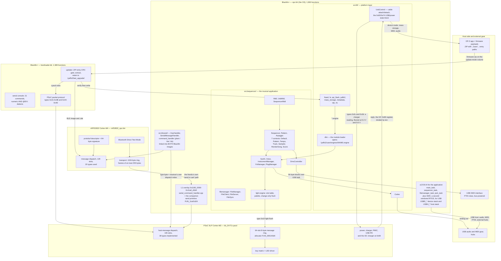
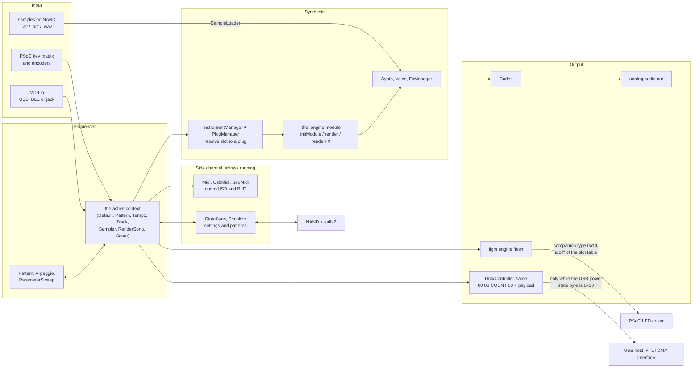
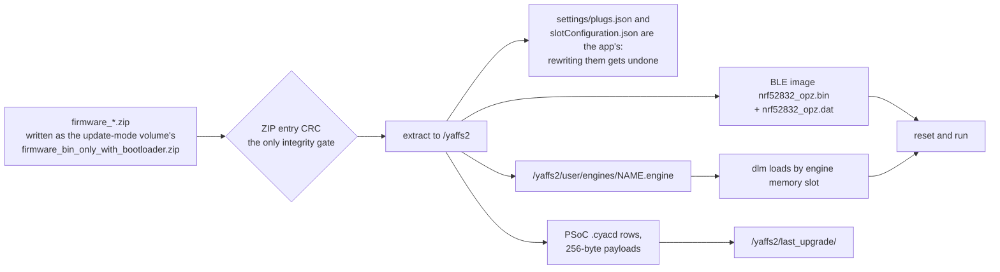

# 10 — Architecture and data flow, as two diagrams

This document is a map, not a source of new findings. Everything in it is drawn from the other nine
documents; where an edge is an inference rather than a read fact, it is marked in §10.4 rather than
smoothed over. Its purpose is orientation: after reading docs `01`–`09` a reader knows a great deal
about individual subsystems and still cannot see the shape of the thing.

Both diagrams are Mermaid, so they render in any Markdown viewer that supports it (GitHub does).

## 10.1 The architecture: three processors, two RTOSes, one source tree

**Reading it.** The unit is not one computer. The **Blackfin+** runs the music application on
uC/OS-III and the USB stacks on a second, commercial RTOS (SMX) — two RTOSes side by side with an
`OSAL` shim between them (doc `06` §6.1). The **nRF52832** is the radio, and it is a peer rather than
a modem: it has its own 129-slot message dispatcher, its own protobuf descriptor, and a Direct Test
Mode that the *Blackfin* can command (doc `04` §4.6b). The **PSoC 5LP** is not a keyboard controller
— it is the power, charging and USB-PD subsystem that also happens to scan the keys and drive the
LEDs (doc `07` §7.4c). The **bootloader** is a separate Blackfin image, and it is the only actor that
can write the other two CPUs.

Two structural notes that took work to see. `src/shared/` is **compiled into both Blackfin images**,
which is why the console's command vocabulary appears in the bootloader and the OS alike (doc `01`,
the "Source tree and build environment" section). And the `0x1180_0000`/`0x11a0_0000` region is a **separately loaded L1 overlay** holding
`serial_command_handler.cpp` and the companion send primitive `FUN_11a01d24`; the rest of that span
is mostly zeros, which is why a naive sweep of it burns its whole instruction budget (doc `09` §9.4).

## 10.2 The basic data flows: sound, notes and light

The runtime path. One diagram, left to right: what comes in, what turns it into sound, and what
leaves as light.

**Reading it.** The centre of gravity is the **context** object: input does not go straight to the
synth, it goes to whichever of the seven contexts is active, and that context both drives the voices
and paints the lights. The lighting is not a side effect of the audio at all — `FUN_8003ac64` derives
its per-fixture preview flags by switching on the **note byte** of each track record (doc `05` §5.8c),
so the LED and DMX state is computed from the same note stream that feeds the engines.

Three flows in this diagram have a gate worth remembering:

- **Audio to the outside** needs the engines loaded; a slot whose `.engine` will not load is silent,
  and the log says `Can't load engine <id>` (that is what the recovery work in the repository's
  `FIRMWARE_ANALYSIS.md` was fixing).
- **Light out** is a *difference*, not a frame: the flush walks the 53-record table, compares against
  a second copy, and emits only the 6-byte changes, capped at 154 bytes (doc `08` §8.4).
- **DMX out** is gated on the USB power state byte at `0x801fa75` being exactly `0x10` (doc `05`
  §5.8b), and it leaves through the **host** stack to an FTDI interface, not through the device port.

## 10.3 The other basic flow: content and firmware

Kept separate because it has different actors — this is the only flow where the bootloader and the
host are both in charge.

**Reading it.** The gate is the **ZIP entry CRC**, decompiled rather than assumed (doc `03` §3.3) —
which is why the per-line `.cyacd` trailer needs no reproduction, an item this project closed and
should not reopen (doc `07` §7.4). The two settings files are listed because overwriting them is the
classic mistake: the app owns them and will restore its own copies. And `/yaffs2/firmware_auto.zip`
is a second entry point to this same flow — a file-presence hook checked at boot (doc `04` §4.5c).

## 10.4 What these diagrams deliberately do not claim

A map that overstates itself is worse than no map, so the boundaries:

- **The wires between the chips are not established.** The diagrams label edges by *protocol* (the companion
  type byte, the packet protocol, the transport ring) because that is what was read. Only one edge names a
  transport at all — the Nordic's `uart` path, and only because `FUN_00027e0c` and its `Failed to send to uart`
  string name it. Which physical bus the companion message channel crosses is not settled here.
- **The companion bus is drawn bidirectional, and only some directions are proven.** Blackfin → PSoC
  is well evidenced for several types; the PSoC → Blackfin direction is evidenced by reply-building
  code (doc `07` §7.4c) but not enumerated type by type.
- **The audio block is coarse on purpose.** `Codec` is a named translation unit and
  `g_audio.suspend()` is a named call, but the codec's register sequence and the exact routing through
  the L1 overlay were not read, so `Codec --> analog out` is a summary, not a traced path.
- **`jack_task` is not placed.** It is a named task and a named semaphore exists (`Failed to post to
  jack semaphore?`), but what the jack is — audio detect, a line module, CV — is not established, so
  it appears only in §10.1's task list.
- **The L1 overlay is a box, not a description.** Its two clusters are named by what was found in
  them; its full contents are unmapped.
- **The `nRF52832` and `PSoC` inboxes are drawn as one node each.** Both have their own two-level
  dispatch, ring buffers and hardware helpers; those are in doc `07`, not here.
